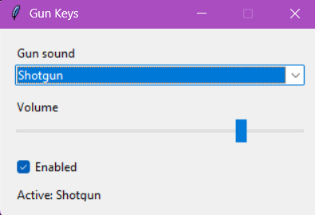

# Gun Keys
Plays a gun sound on every keypress (Windows). Pick the gun from a dropdown, adjust the volume, and toggle it on or off.

## Screenshot

![App screenshot]

## Setup
python -m venv venv
venv\Scripts\activate
pip install -r requirements.txt

## Run
Put .wav/.ogg/.mp3 files in a `sounds` folder, then:
python main.py
